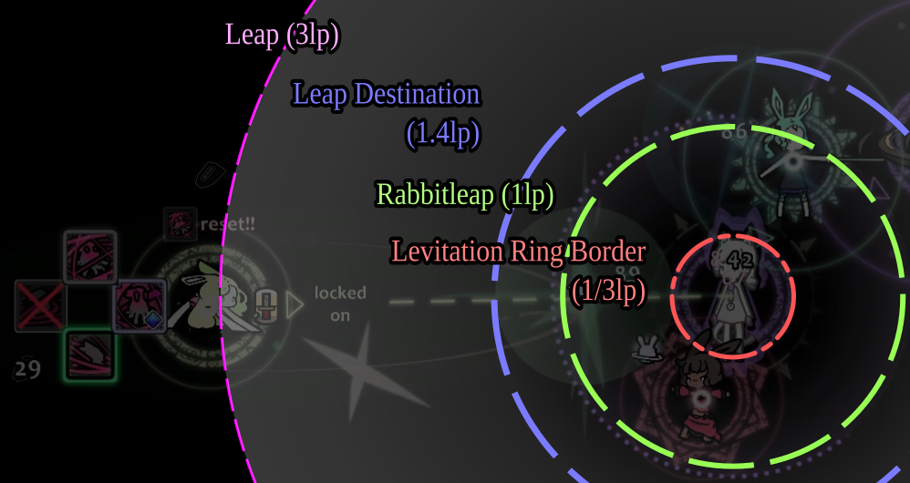
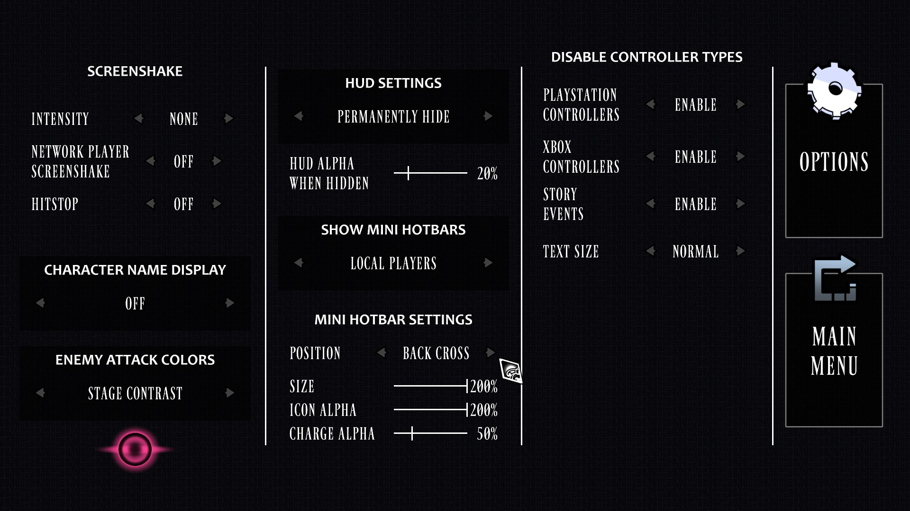
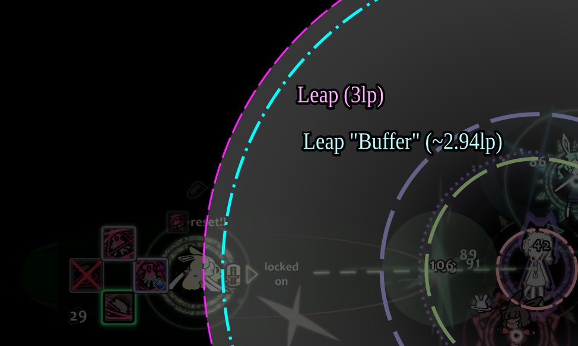

#+HUGO_BASE_DIR: .
#+HUGO_SECTION: doc

#+title: Something about Shadow
#+subtitle: ({{{guidever}}})
#+description: Unofficial Shadow Class guide for the Rabbit & Steel game.
#+author: Quoise
#+date: {{{modification-time(%Y-%m-%d)}}}
#+include: macros.org
:PREFERENCES:
#+startup: inlineimages
#+bind: org-latex-image-default-width "1.8em"
#+bind: org-latex-images-centered nil
#+bind: org-footnote-section nil
#+bind: org-hide-macro-markers t
#+OPTIONS: ^:nil num:3 todo:nil
#+EXPORT_FILE_NAME: index
#+LATEX_HEADER: \usepackage[colorlinks=true,urlcolor=pink,linkcolor=blue]{hyperref}
#+HTML_HEAD: <link rel="stylesheet" type="text/css" href="./styles/gongzhitaao-org.css"/>
#+HTML_HEAD: <link rel="stylesheet" type="text/css" href="./styles/hint.base.css">
#+HTML_HEAD_EXTRA: 
#+HTML_HEAD_EXTRA: 
#+HTML_HEAD_EXTRA: 
#+INFOJS_OPT: view:info sdepth:1 tdepth:1 path:'./js/org-info.js'
:END:
:TODOs:
#+TODO: TODO(t) DRAFT(D) | REVIEW(r)
#+TODO: | DONE(d)
#+TODO: | RENEW(R)
#+TODO: | CANCELLED(c)
:END:
:MACROS:
#+MACRO: gem [[./img/gems/$1.png]]
#+MACRO: gems [[./img/gems-40px/$1.png]]
#+MACRO: gemss [[./img/gems-40px/$1.png]]
#+MACRO: abl [[./img/abilities-40px/$1.png]]
#+MACRO: abls [[./img/abilities-40px/$1.png]]
#+MACRO: Shackle 
#+MACRO: Shackles {{{i1}}}{{{tShackles}}}{{{i2}}}{{{Shackle}}} {{{span_dot}}}Shackles{{{span_end}}}{{{i3}}}
#+MACRO: gamever v2.0.2.7
#+MACRO: guidever v0.5.0
#+MACRO: WIP @@html:@@WIP@@html:@@
:END:
:MACROS_ABBREVIATIONS:
#+MACRO: pri {{{abl(N1)}}} *Primary*
#+MACRO: sec {{{abl(N2)}}} *Secondary*
#+MACRO: secl {{{abl(N2)}}} *Leap Secondary*
#+MACRO: spe {{{abl(N3)}}} *Special*
#+MACRO: def {{{abl(N4)}}} *Defensive*
#+MACRO: N1 {{{i1}}}{{{tN1}}}{{{i2}}}{{{abls(N1)}}} {{{span_dot}}}N1{{{span_end}}}{{{i3}}}
#+MACRO: N2 {{{i1}}}{{{tN2}}}{{{i2}}}{{{abls(N2)}}} {{{span_dot}}}N2{{{span_end}}}{{{i3}}}
#+MACRO: N3 {{{i1}}}{{{tN3}}}{{{i2}}}{{{abls(N3)}}} {{{span_dot}}}N3{{{span_end}}}{{{i3}}}
#+MACRO: N4 {{{i1}}}{{{tN4}}}{{{i2}}}{{{abls(N4)}}} {{{span_dot}}}N4{{{span_end}}}{{{i3}}}
#+MACRO: O1 {{{i1}}}{{{tO1}}}{{{i2}}}{{{gems(O1)}}} {{{span_dot}}}O1{{{span_end}}}{{{i3}}}
#+MACRO: O2 {{{i1}}}{{{tO2}}}{{{i2}}}{{{gems(O2)}}} {{{span_dot}}}O2{{{span_end}}}{{{i3}}}
#+MACRO: O3 {{{i1}}}{{{tO3}}}{{{i2}}}{{{gems(O3)}}} {{{span_dot}}}O3{{{span_end}}}{{{i3}}}
#+MACRO: O4 {{{i1}}}{{{tO4}}}{{{i2}}}{{{gems(O4)}}} {{{span_dot}}}O4{{{span_end}}}{{{i3}}}
#+MACRO: S1 {{{i1}}}{{{tS1}}}{{{i2}}}{{{gems(S1)}}} {{{span_dot}}}S1{{{span_end}}}{{{i3}}}
#+MACRO: S2 {{{i1}}}{{{tS2}}}{{{i2}}}{{{gems(S2)}}} {{{span_dot}}}S2{{{span_end}}}{{{i3}}}
#+MACRO: S3 {{{i1}}}{{{tS3}}}{{{i2}}}{{{gems(S3)}}} {{{span_dot}}}S3{{{span_end}}}{{{i3}}}
#+MACRO: S4 {{{i1}}}{{{tS4}}}{{{i2}}}{{{gems(S4)}}} {{{span_dot}}}S4{{{span_end}}}{{{i3}}}
#+MACRO: R1 {{{i1}}}{{{tR1}}}{{{i2}}}{{{gems(R1)}}} {{{span_dot}}}R1{{{span_end}}}{{{i3}}}
#+MACRO: R2 {{{i1}}}{{{tR2}}}{{{i2}}}{{{gems(R2)}}} {{{span_dot}}}R2{{{span_end}}}{{{i3}}}
#+MACRO: R3 {{{i1}}}{{{tR3}}}{{{i2}}}{{{gems(R3)}}} {{{span_dot}}}R3{{{span_end}}}{{{i3}}}
#+MACRO: R4 {{{i1}}}{{{tR4}}}{{{i2}}}{{{gems(R4)}}} {{{span_dot}}}R4{{{span_end}}}{{{i3}}}
#+MACRO: G1 {{{i1}}}{{{tG1}}}{{{i2}}}{{{gems(G1)}}} {{{span_dot}}}G1{{{span_end}}}{{{i3}}}
#+MACRO: G2 {{{i1}}}{{{tG2}}}{{{i2}}}{{{gems(G2)}}} {{{span_dot}}}G2{{{span_end}}}{{{i3}}}
#+MACRO: G3 {{{i1}}}{{{tG3}}}{{{i2}}}{{{gems(G3)}}} {{{span_dot}}}G3{{{span_end}}}{{{i3}}}
#+MACRO: G4 {{{i1}}}{{{tG4}}}{{{i2}}}{{{gems(G4)}}} {{{span_dot}}}G4{{{span_end}}}{{{i3}}}
#+MACRO: E1 {{{i1}}}{{{tE1}}}{{{i2}}}{{{gems(E1)}}} {{{span_dot}}}E1{{{span_end}}}{{{i3}}}
#+MACRO: E2 {{{i1}}}{{{tE2}}}{{{i2}}}{{{gems(E2)}}} {{{span_dot}}}E2{{{span_end}}}{{{i3}}}
#+MACRO: E3 {{{i1}}}{{{tE3}}}{{{i2}}}{{{gems(E3)}}} {{{span_dot}}}E3{{{span_end}}}{{{i3}}}
#+MACRO: E4 {{{i1}}}{{{tE4}}}{{{i2}}}{{{gems(E4)}}} {{{span_dot}}}E4{{{span_end}}}{{{i3}}}
#+MACRO: O1s {{{i1}}}{{{tO1}}}{{{i2}}}{{{gemss(O1)}}}{{{i3}}}
#+MACRO: O2s {{{i1}}}{{{tO2}}}{{{i2}}}{{{gemss(O2)}}}{{{i3}}}
#+MACRO: O3s {{{i1}}}{{{tO3}}}{{{i2}}}{{{gemss(O3)}}}{{{i3}}}
#+MACRO: O4s {{{i1}}}{{{tO4}}}{{{i2}}}{{{gemss(O4)}}}{{{i3}}}
#+MACRO: S1s {{{i1}}}{{{tS1}}}{{{i2}}}{{{gemss(S1)}}}{{{i3}}}
#+MACRO: S2s {{{i1}}}{{{tS2}}}{{{i2}}}{{{gemss(S2)}}}{{{i3}}}
#+MACRO: S3s {{{i1}}}{{{tS3}}}{{{i2}}}{{{gemss(S3)}}}{{{i3}}}
#+MACRO: S4s {{{i1}}}{{{tS4}}}{{{i2}}}{{{gemss(S4)}}}{{{i3}}}
#+MACRO: R1s {{{i1}}}{{{tR1}}}{{{i2}}}{{{gemss(R1)}}}{{{i3}}}
#+MACRO: R2s {{{i1}}}{{{tR2}}}{{{i2}}}{{{gemss(R2)}}}{{{i3}}}
#+MACRO: R3s {{{i1}}}{{{tR3}}}{{{i2}}}{{{gemss(R3)}}}{{{i3}}}
#+MACRO: R4s {{{i1}}}{{{tR4}}}{{{i2}}}{{{gemss(R4)}}}{{{i3}}}
#+MACRO: G1s {{{i1}}}{{{tG1}}}{{{i2}}}{{{gemss(G1)}}}{{{i3}}}
#+MACRO: G2s {{{i1}}}{{{tG2}}}{{{i2}}}{{{gemss(G2)}}}{{{i3}}}
#+MACRO: G3s {{{i1}}}{{{tG3}}}{{{i2}}}{{{gemss(G3)}}}{{{i3}}}
#+MACRO: G4s {{{i1}}}{{{tG4}}}{{{i2}}}{{{gemss(G4)}}}{{{i3}}}
#+MACRO: E1s {{{i1}}}{{{tE1}}}{{{i2}}}{{{gemss(E1)}}}{{{i3}}}
#+MACRO: E2s {{{i1}}}{{{tE2}}}{{{i2}}}{{{gemss(E2)}}}{{{i3}}}
#+MACRO: E3s {{{i1}}}{{{tE3}}}{{{i2}}}{{{gemss(E3)}}}{{{i3}}}
#+MACRO: E4s {{{i1}}}{{{tE4}}}{{{i2}}}{{{gemss(E4)}}}{{{i3}}}
#+MACRO: O1g {{{i1}}}(O1) {{{tO1}}}{{{i2}}}{{{gem(O1)}}}{{{i3}}}
#+MACRO: O2g {{{i1}}}(O2) {{{tO2}}}{{{i2}}}{{{gem(O2)}}}{{{i3}}}
#+MACRO: O3g {{{i1}}}(O3) {{{tO3}}}{{{i2}}}{{{gem(O3)}}}{{{i3}}}
#+MACRO: O4g {{{i1}}}(O4) {{{tO4}}}{{{i2}}}{{{gem(O4)}}}{{{i3}}}
#+MACRO: S1g {{{i1}}}(S1) {{{tS1}}}{{{i2}}}{{{gem(S1)}}}{{{i3}}}
#+MACRO: S2g {{{i1}}}(S2) {{{tS2}}}{{{i2}}}{{{gem(S2)}}}{{{i3}}}
#+MACRO: S3g {{{i1}}}(S3) {{{tS3}}}{{{i2}}}{{{gem(S3)}}}{{{i3}}}
#+MACRO: S4g {{{i1}}}(S4) {{{tS4}}}{{{i2}}}{{{gem(S4)}}}{{{i3}}}
#+MACRO: R1g {{{i1}}}(R1) {{{tR1}}}{{{i2}}}{{{gem(R1)}}}{{{i3}}}
#+MACRO: R2g {{{i1}}}(R2) {{{tR2}}}{{{i2}}}{{{gem(R2)}}}{{{i3}}}
#+MACRO: R3g {{{i1}}}(R3) {{{tR3}}}{{{i2}}}{{{gem(R3)}}}{{{i3}}}
#+MACRO: R4g {{{i1}}}(R4) {{{tR4}}}{{{i2}}}{{{gem(R4)}}}{{{i3}}}
#+MACRO: G1g {{{i1}}}(G1) {{{tG1}}}{{{i2}}}{{{gem(G1)}}}{{{i3}}}
#+MACRO: G2g {{{i1}}}(G2) {{{tG2}}}{{{i2}}}{{{gem(G2)}}}{{{i3}}}
#+MACRO: G3g {{{i1}}}(G3) {{{tG3}}}{{{i2}}}{{{gem(G3)}}}{{{i3}}}
#+MACRO: G4g {{{i1}}}(G4) {{{tG4}}}{{{i2}}}{{{gem(G4)}}}{{{i3}}}
#+MACRO: E1g {{{i1}}}(E1) {{{tE1}}}{{{i2}}}{{{gem(E1)}}}{{{i3}}}
#+MACRO: E2g {{{i1}}}(E2) {{{tE2}}}{{{i2}}}{{{gem(E2)}}}{{{i3}}}
#+MACRO: E3g {{{i1}}}(E3) {{{tE3}}}{{{i2}}}{{{gem(E3)}}}{{{i3}}}
#+MACRO: E4g {{{i1}}}(E4) {{{tE4}}}{{{i2}}}{{{gem(E4)}}}{{{i3}}}
:END:

* RENEW Intro
:PROPERTIES:
:CUSTOM_ID: h:intro
:END:

#+begin_center
@@html:<b><u>@@
This guide is in
@@html:@@
review phase.
@@html:@@
@@html:</b></u>@@

@@html:<b><u>@@
Please feel free to send any feedback or corrections in ~mino_dev~ Discord.
Additions would be welcome.
@@html:</b></u>@@
#+end_center

Post class-rework Shadow Class guide written primarily for {{{gamever}}} of Rabbit & Steel.

Primarily, the recommendations here are targetted as a carry at 4P Lunar
and high WR consistency and with tactless author bias.

#+begin_quote
[Author] I'm primarily a Dancer main first with 260 Lunar Wins; some of these come from
4P nohits, 4P 1.5x (Game Speed) DT and 4P Touhou wins.

On Shadow, I currently have 72 MP Lunar wins and 62 Total Hard wins.
#+end_quote

This guide could not be made possible without the help of other players in mino_dev Discord.

Special thanks to Obi Rod, Ins'Ania and Kero for early help.
# check to see if said players are okay with being mentioned in guide.

** DONE Related Resources
:PROPERTIES:
:CUSTOM_ID: h:related_resources
:END:

Details of Shadow's kit can be found in:
- [[https://rns.miraheze.org/wiki/Shadow][Shadow | Rabbit & Steel Wiki (rns.miraheze.org)]]
  
For latest available guides:
- [[https://discord.com/channels/496640298844422149/1238375581486288916][Guides Catalogue maintained by Stagz | mino_dev Discord (discord.com)]]

For community jargon:
- [[https://docs.google.com/document/d/1rrSEIEstdKtajTY1xkXWoQKw3BIz4eENyJBHiyqCKcU/edit?tab=t.0][Rabbit & Steel Community Jargon by tomeking (docs.google.com)]] 

# attributions and claims to not own used images of R&S Loot + Gems

** DONE Sample Definitions
:PROPERTIES:
:CUSTOM_ID: h:sample_definitions
:END:

- {{{N1}}}, {{{O1}}}, {{{S1}}}, {{{R1}}}, {{{E1}}}, {{{G1}}} :: _Normal_ and _gem_ variants of Primary.
- {{{R1}}}, {{{R2}}}, {{{R3}}}, {{{R4}}} :: _Ruby_ variants of each respectively: Primary, Secondary, Special and Defensive.
- $2' \ggg 3 > 1 > 4 > 2$ :: move priority for {{{R2}}}
  + {{{secl}}} ($2'$) is drastically favoured and clicked whenever available;
  + Followed by Special, Primary, Defensive and (non-leap) Secondary.
- AoE :: Area-of-Effect; typically used in context of hitting multiple enemies, e.g. fights in Churchouse or Sanctum.
- oGCD :: Shadow's S3, S4; these can be used without sacrificing GCD time spent on other
- prio :: priority; typically what item/gems should be picked and by whom
  + BiS :: Best in Slot; universal best upgrade.
  + line :: if buying a gem, typically how broad or strong its item-gem synergies are.
- slam :: a forced gem-item pick to solve the immediate stage/encounter.
  + In R&S, often this does expand your item lines off base, even if not BiS.

* REVIEW Class Summary
:PROPERTIES:
:CUSTOM_ID: h:class_summary
:END:

Shadow is a mobile close-quarters bunny with a potent versatility; she excels when playing flexibly, due to {{{Shackles}}}.
Many of her effects are unique or inspired from other classes and effects.

Shadow is best characterized by having:
- Decent-damage and short GCD (1.0s) abilities.
  + Close-Range multi-hit {{{abl(N1)}}} *Primary* and {{{abl(N2)}}} *Secondary* abilities.
    + No slows on these abilities.
  + {{{abl(N2)}}} *Secondary* having a leap, similar to Heavyblade's (HB) Special.
  + {{{abl(N3)}}} *Special* that hits all enemies on short CD.
  + {{{abl(N4)}}} *Defensives* with damage and GCD.
- Shares the fastest base movement speed (m/s) with Assassin (Sin).
- {{{Shackles}}} status effect.

#+caption: Class Advantages Table
| Pros                                   | Cons                                        |
|----------------------------------------+---------------------------------------------|
| Unique, gacha-like effects             | Defensive has GCD                           |
| Higher APM                             | Complex rotations ({{{Shackles}}})                |
| Secondary invulnerability              | Punishes bad targetting and leaps           |
| Global+4P damage multipliers ({{{O2s}}} {{{G3s}}}) | Weak Special-only builds                    |
| Consistent damage and AoE solves       | Almost 0 hacky Rabbitluck 8k+ damage builds |
|                                        | Contests most items of Sin                  |

** REVIEW General Gameplan
:PROPERTIES:
:CUSTOM_ID: h:gameplan
:END:

Shadow typically should be playing up close.
In more optimal play with {{{R1}}} / {{{R2}}} / {{{R4}}},
you should be playing just under 3 Rabbitleaps, then moving out enable leap when you need it.

In MP, Shadow adjusts by walking for teammates as she shares _fastest base speed with Assassin_ and, like Sin,
has no slows on two of three attacks.

*** REVIEW Multiplayer Item Conflicts
:PROPERTIES:
:CUSTOM_ID: h:mp_conflict
:END:

Most item conflicts do and _should occur with Sin, Dancer, SS and Druid._
- 1P: Shadow build towards Primary, Secondary builds, multihit or low GCD.
- 4P: Shadow omits Primary typically, but same pattern.

# # Way too complicated to keep, better to diagram?
# Here's the overlying archetypes that Shadow typically should build for Secondary and multihit.
# - Multihit and Bleed :: _Assassin_, _Dancer_, _Druid_, _Spellsword_, _Sniper_, Grenadier
# - Secondary :: _Assassin_, _Dancer_, _Druid_, Sniper, Ancient, Grenadier
# - Primary :: Assassin, _Heavyblade_, Sniper, _Bruiser_, _Hammermaid_, _Grenadier_
# - Low GCD :: _Assassin_ (S2/O2), _Bruiser_, _Spellsword_, (pubs) Grenadier

#+begin_quote
Pubs Grens may also contest low GCD/trigger items, though they have alternate lines and GCD cancel.
#+end_quote

*** TODO First Shop Buys and Slams :noexport:
:PROPERTIES:
:CUSTOM_ID: h:shop
:END:

*** DRAFT Scaling Ability Damage
:PROPERTIES:
:CUSTOM_ID: h:scale_ability
:END:

Most of the time on Shadow, your damage will come from abilities, so you often want a mix of (non-exhaustive):

1. High base damage abilities ({{{R1s}}}, {{{R2s}}}, {{{O3s}}})
2. Autocast abilities and oGCD ({{{R4s}}} \ggg {{{S1s}}}, {{{G1s}}}, {{{S3s}}})
3. Additive or percent damage ({{{i(Pocketwatch)}}}, {{{i(Shadow-Bracelet)}}})
   + Additionally, Bleed and sap effects ({{{i(Leech-Staff)}}}, {{{i(Blood-Vial)}}})
4. Curse ({{{O2s}}}, {{{i(Curse-Talon)}}}, {{{i(Darkmagic-Blade)}}})
5. Buffs ({{{G3}}}, {{{i(Butterfly-Hairpin)}}})
   + Multihit focus ({{{O4s}}},  {{{i(Crane-Katana)}}} / {{{i(Falconfeather-Dagger)}}})
   + Large base focus ({{{i(Beach-Sandals)}}} / {{{i(Flamedancer-Dagger)}}})
6. Critical hit items ({{{i(Pointed-Ring)}}})

See [[#h:ability_synergies][Ability synergies]] for specific synergies.

** REVIEW Shackles
:PROPERTIES:
:CUSTOM_ID: h:shackles
:END:

Shadow's {{{Shackles}}} locks up one of her attacks[fn:attacks:Attacks include {{{pri}}}, {{{sec}}}, {{{spe}}}.] from use on any ability usage.
This is independent of any Magicklock trinket effects, cooldowns or item effects (e.g. {{{Lefthand-Cast}}}.)

# This doesn't feel as relevant, but I'll quote it.
#+begin_quote
[Author] As well, this can freeze up your inputs where otherwise, on other characters,
you could hold down {{{sec}}} and {{{spe}}}.
#+end_quote

** REVIEW Inspirations from other Classes and Loot
:PROPERTIES:
:CUSTOM_ID: h:inspirations
:END:

Shadow gains some distinct effects that appear in other classes, namely:
- {{{S2}}}'s range and charge effect like Dancer's Secondary.
- {{{G3}}} granting the Shadowcry buff, similar to Dancer's Defensive and better uptime.
- {{{O2}}} granting Shadowcurse debuff, similar to Spellsword's (SS) Opal Defensive and better uptime.
- {{{G1}}} granting 100 damage 25% of the time to all enemies, is practically a {{{Brightstorm-Spear}}} and {{{Darkstorm-Knife}}}.
# too exhaustive?
# - {{{S1}}}, {{{S4}}} oGCD's
# - {{{S1}}}, {{{G1}}} and {{{R4}}} automatic abilities (do not trigger items that require /use/, i.e. {{{Black-Wakizashi}}})

** REVIEW Gacha ability
:PROPERTIES:
:CUSTOM_ID: h:gacha
:END:

{{{E3}}} grants Shadow common access to, often loot-only or class-exclusive, effects like Berserk, Sap and Blackstrike.
This distinctly allows Shadow to build into debuffs, multi-hit (on Special); or support most Shadow builds.
- See [[https://rns.miraheze.org/wiki/Shadow][Shadow (rns.miraheze.org)]] for exhaustive list of effects.

* REVIEW Move Priority (/Rotations/)
:PROPERTIES:
:CUSTOM_ID: h:rotation
:END:

Shadow's abilities' damage are more "symmetrical" at base kit.
The base kit optimization below are in magnitudes of about \pm20dps (10%) and only
_only valid if attacks hit consistently_.

#+name: rotations
#+caption: Common Move Priorities off Base Kit
| Base*   | $3 > 1 > 4 > 2$                              |
| {{{R2}}} \lor {{{R4}}} | $2' \ggg 3 > 4 > 1 > 2$                         |
| {{{E2}}}      | $2 \ggg 3 > 4 > 1$                              |
| {{{S1}}} \lor {{{G1}}} | $2 > 3 > 4 > 1$                              |
| {{{R1}}}      | $\text{Repeat}(1'' \rightarrow 2' \lor 4) \gg \text{Base}$ |
| {{{S4}}} \lor {{{O4}}} | $4 > 3 > 1 > 2$                              |
| {{{E4}}}      | $4 > 1 > 3 > 2$                              |
@@html:
@@
*Based on MDP; in Outskirts, force {{{N4}}} by 6s and 21s (twice),
can reach 9 gold easier if the enemy is beaten by 22.5s.

Leaps are designated by $2'$; charge by $2''$.

{{{spe}}} (3) can be delayed for mobile enemies.
@@html:
@@

In fights with _multiple enemies_, like *Churchmouse Streets'* Matti's P2 mice ads or *Geode* Plee,
save your {{{spe}}} or {{{def}}} until they spawn.

For *Darkhouse Depths'* Darkbeast Tauros, due to her zoning,
use the late hit animations of {{{pri}}} and {{{def}}} to deal damage consistently.

** REVIEW Ruby Leap Archetypes - R2/R4
:PROPERTIES:
:CUSTOM_ID: h:ruby_leap
:END:
#+MACRO: pb @@html: <b>@@$1@@html: </b>@@

# link to short YT clip displaying this
For normal-sized enemies, play near 3 Rabbitleaps away.
1. Position near {{{pb(leap)}}} border;
2. If {{{sec}}} is--
   a. Available \rightarrow move outside (leap enables) and use {{{sec}}};
   b. {{{Shackles}}} \rightarrow Either--
      + Move inside to hit Primary/Defensive;
      + Special;
3. Repeat.

Larger enemies like *Red Darkhouse* Ranalie P2 allow you to leap without lunging forward.

#+name: fig:rabbitleap
#+CAPTION: Distances in Rabbitleaps (lp) with Stella

*** REVIEW Alt: Omegacharge Ruby Primary (R1)
:PROPERTIES:
:CUSTOM_ID: h:r1
:END:

# unnecessary to include?
Same principle to activate leap above:
1. One of {{{secl}}} / {{{S2}}} / {{{def}}};
2. {{{R1}}};
3. Repeat.

* REVIEW Ability synergies
:PROPERTIES:
:CUSTOM_ID: h:ability_synergies
:END:

Unique or notable gem and item synergies are only presented.

Generic item damage bonuses are assumed:
- Most abilities/gems love multi-hits like {{{Shadow-Bracelet}}}, {{{Youkai-Bracelet}}}, Bleed items-...
- Certain items like {{{Lefthand-Cast}}}, {{{Witchs-Cloak}}} and {{{Darkcloud-Necklace}}} become viable when Shadow has sufficient damage in loot items.

Also most gems here are universally good with {{{O2}}}, {{{G3}}} and {{{O4}}}.

** REVIEW Primary
:PROPERTIES:
:CUSTOM_ID: h:primary
:END:
#+MACRO: N1i {{{i(Waterfall-Polearm)}}} {{{i(Crane-Katana)}}}
#+MACRO: O1i {{{i(Sand-Shovel)}}} {{{i(Miners-Headlamp)}}} {{{i(Large-Anchor)}}} {{{i(Lefthand-Cast)}}}
#+MACRO: S1i {{{i(Crane-Katana)}}} {{{i(Windbite-Dagger)}}} {{{i(Giant-Stone-Club)}}} {{{i(Hexed-Blindfold)}}}
#+MACRO: R1i {{{N1i}}} {{{i(Firststrike-Bracelet)}}} {{{i(Garnet-Staff)}}}(\rightarrow {{{i(Obsidian-Hairpin)}}}) {{{i(Flamedancer-Dagger)}}}
#+MACRO: G1i {{{i(Crane-Katana)}}} {{{i(Colorful-Earrings)}}} {{{i(Lightning-Bow)}}} {{{i(Crown-of-Storms)}}} {{{i(Usagi-Kamen)}}} {{{i(Giant-Stone-Club)}}} {{{i(Vega-Spear)}}} {{{i(Hexed-Blindfold)}}}
#+MACRO: E1i {{{N1i}}} {{{i(Firststrike-Bracelet)}}} {{{i(Midsummer-Dress)}}} {{{i(Abyss-Artifact)}}} {{{i(Flamedancer-Dagger)}}} {{{i(Whiteflame-Staff)}}} {{{i(Hexed-Blindfold)}}}
#+MACRO: E1n "Needs" slow bypass, but best internal multi-hit and good snapshot buff synergy

| Gem | Gem Synergies           | Item Synergies | Notes                                                                  |
|-----+-------------------------+----------------+------------------------------------------------------------------------|
| {{{N1}}}  | {{{O2s}}} {{{G3s}}}                 | {{{N1i}}}            | Good class N1, main ability to click on base                           |
| {{{O1}}}  | {{{O2s}}} {{{E3s}}} \ggg {{{S3s}}}           | {{{O1i}}}            | {{{G2}}} variant for {{{E3}}}, Special and loot CD—generally bad though.          |
| {{{S1}}}  | {{{O2s}}} {{{G3s}}} {{{O4s}}}             | {{{S1i}}}            | +100 on Secondary, more consistent than {{{G1}}} for single enemies          |
| {{{R1}}}  | {{{O2s}}} {{{S2s}}} {{{R2s}}} {{{E2s}}} {{{O4s}}} {{{G3s}}} | {{{R1i}}}            | _600dmg on only iframe req_; easiest with {{{S2}}}, good with snapshot buffs   |
| {{{G1}}}  | All (-{{{G2s}}}/-{{{R3s}}})         | {{{G1i}}}            | Avg +25 dmg on other ability hits, decent AoE and best % proc trigger. |
| {{{E1}}}  | {{{S3s}}} {{{O2s}}} {{{E3s}}} {{{O4s}}}         | {{{E1i}}}            | {{{E1n}}}                                                                    |

#+begin_quote
{{{S1}}} and {{{G1}}} effects does not trigger "use" abilities like {{{Black-Wakizashi}}} or {{{Golden-Katana}}}, but can trigger {{{Brightstorm-Spear}}}.

{{{S1}}} and {{{G1}}} are fine with taking +GCD (includes {{{R1}}} to some extent.)

{{{E1}}} 2s GCD effect can't be cheated via GCD items, Berserk, Quickdraw or even {{{Shinsoku-Katana}}}.
At base kit, the effect triggers {{{Pocketwatch}}}, but not {{{Sacredstone-Charm}}}.

{{{E1}}} ~1.5s slow on effect can be bypassed with Berserk, Super, Flutterstep, {{{E3}}}, and {{{Midsummer-Dress}}}.
{{{S3}}} cancels this slow when used immediately after.
#+end_quote

** REVIEW Secondary
:PROPERTIES:
:CUSTOM_ID: h:secondary
:END:
#+MACRO: N2i {{{i(Butterfly-Hairpin)}}} {{{i(Cavers-Cloak)}}} {{{i(Vorpal-Dao)}}} {{{i(Falconfeather-Dagger)}}}
#+MACRO: O2i {{{n2i}}} {{{i(Artist-Smock)}}} {{{i(Redblack-Ribbon)}}} (Loot/debuff damage items)
#+MACRO: S2i {{{n2i}}} {{{i(Sandpriestess-Spear)}}} {{{i(Marble-Clasp)}}} {{{i(Hexed-Blindfold)}}}
#+MACRO: R2i {{{n2i}}} {{{i(Reddragon-Blade)}}} {{{i(Greysteel-Shield)}}} {{{i(Marble-Clasp)}}} 
#+MACRO: G2i {{{i(Jesters-Hat)}}} {{{i(Colorful-Earrings)}}} {{{i(Lightning-Bow)}}} {{{i(Crown-of-Storms)}}} {{{i(Usagi-Kamen)}}} {{{i(Rosered-Leotard)}}}
#+MACRO: E2i {{{n2i}}} {{{i(Hexed-Blindfold)}}}
#+MACRO: O2n SS superhex (universal damage mult.); scales loot and team damage, unlike others

| Gem | Leap | Gem Synergies   | Item Synergies | Notes                                                 |
|-----+------+-----------------+----------------+-------------------------------------------------------|
| {{{N2}}}  | Y    | {{{R4s}}} {{{G3s}}}         | {{{N2i}}}            | Good class N2                                         |
| {{{O2}}}  | Y    | All             | {{{O2i}}}            | {{{O2n}}}                                                   |
| {{{S2}}}  | -    | {{{R4s}}} {{{R1s}}} {{{S3s}}} {{{G3s}}} | {{{S2i}}}            | Ranged secondary and wide-hitbox, easy uptime         |
| {{{R2}}}  | Y    | {{{R4s}}} {{{O4s}}} {{{S3s}}} {{{G3s}}} | {{{R2i}}}            | _"Supercharge" double damage effect_ with only leap req |
| {{{G2}}}  | -    | {{{E3s}}} {{{G4}}} \ggg {{{S4s}}}    | {{{G2i}}}            | Good with oGCD gems; loses Secondary damage           |
| {{{E2}}}  | Y    | {{{R4s}}} {{{G3s}}} {{{S3s}}}     | {{{E2i}}}            | Average upgrade due to {{{Shackles}}}                       |

#+begin_quote
#+end_quote

** REVIEW Special
:PROPERTIES:
:CUSTOM_ID: h:special
:END:
Shadow should _not force Special damage to work in most runs._
so typically you pick up Special for utility (e.g. {{{G3}}}, {{{E3}}} or {{{S3}}}) or AoE damage slam (Sanctum.)

Special scaling sucks on Shadow (due to 250 base),
thus Special-only is heavily dependant on {{{E3}}}, {{{O3}}} or {{{Obsidian-Rod}}}\land{{{R3}}} and synergies.

#+MACRO: N3i {{{i(Deathcap-Tome)}}} {{{i(Cursed-Candlestaff)}}} {{{i(Shockwave-Tome)}}}
#+MACRO: O3i1 {{{i(Miners-Headlamp)}}} {{{i(Darkglass-Spear)}}} {{{i(Timespace-Dagger)}}} {{{i(Firststrike-Bracelet)}}} {{{i(Necronomicon)}}} {{{i(Nova-Crown)}}} {{{i(Battlemaiden-Armor)}}}
#+MACRO: O3i2  {{{i(Raindrop-Earrings)}}} {{{i(Sun-Pendant)}}} {{{i(Heavens-Codex)}}} {{{i(Staff-of-Sorrow)}}} {{{i(Mountain-Staff)}}}
#+MACRO: O3i {{{o3i1}}} {{{o3i2}}}
#+MACRO: S3i {{{n3i}}} {{{i(Hawkfeather-Fan)}}}{{{i(Mermaid-Scalemail)}}}{{{i(Firescale-Corset)}}}{{{i(Mountain-Staff)}}} {{{i(Garnet-Staff)}}}  {{{i(Spear-of-Winds)}}} {{{i(Bolt-Staff)}}}
#+MACRO: R3i {{{i(Obsidian-Rod)}}} {{{i(Garnet-Staff)}}} {{{i(Spear-of-Winds)}}} {{{i(Bolt-Staff)}}} {{{i(Saltwater-Staff)}}}
#+MACRO: G3i {{{n3i}}} {{{i(Sacred-Bow)}}} {{{i(Shrinemaidens-Kosode)}}} {{{i(Reflection-Shield)}}} {{{i(Spiked-Shield)}}} (Loot/debuff damage items)
#+MACRO: E3i [{{{i(Mermaid-Scalemail)}}}/{{{i(Firescale-Corset)}}}/{{{i(Hawkfeather-Fan)}}}(\rightarrow {{{i(Redwhite-Ribbon)}}})] {{{i(Sacred-Bow)}}} {{{i(Shrinemaidens-Kosode)}}} {{{i(Artist-Smock)}}} {{{i(Witchs-Cloak)}}} {{{i(Venom-Hood)}}} {{{i(Miners-Headlamp)}}}
#+MACRO: S3n Good early oGCD damage; no slow (and removes {{{E1}}}/{{{def}}} slow), but terrible damage scaling.
#+MACRO: G3n Dancer Warcry (universal damage mult.); scales loot and team damage consistently (alt: {{{E3}}})

 | Gem | Gem Synergies              | Item Synergies | Notes                                                                 |
 |-----+----------------------------+----------------+-----------------------------------------------------------------------|
 | {{{N3}}}  | {{{O2s}}}                        | {{{N3i}}}            | Weaker class N3, but strong AoE (hits all) and decent debuff Spreader |
 | {{{O3}}}  | (With item reset: {{{O1s}}}) {{{O2s}}} | {{{O3i}}}            | Special damage scaling; huge hitting Special; disables universal %    |
 | {{{S3}}}  | {{{E1s}}} {{{O1s}}} {{{G2s}}} {{{O2s}}}            | {{{S3i}}}            | {{{S3n}}}                                                                   |
 | {{{R3}}}  | {{{O1s}}} {{{G2s}}} {{{O2s}}}                | {{{R3i}}}            | Only good for ads, Obsidian Rod or Special triggers                   |
 | {{{G3}}}  | All                        | {{{G3i}}}            | {{{G3n}}}                                                                   |
 | {{{E3}}}  | {{{E1s}}} {{{O1s}}} {{{G2s}}} {{{O2s}}}            | {{{E3i}}}            | +~33% on Special;[fn:e3] debuff/buff archetype; inconsistent AoE.         |

#+begin_quote
{{{E3}}} is affected by {{{Obsidian-Rod}}}, {{{Cursed-Candlestaff}}}, {{{Old-Bonnet}}} / {{{Haunted-Gloves}}}, {{{Mountain-Staff}}} and other special items changes.
#+end_quote
 
** REVIEW Defensive
:PROPERTIES:
:CUSTOM_ID: h:defensive
:END:
#+MACRO: N4i {{{i(Gladiator-Helmet)}}} {{{i(Battery-Shield)}}} {{{i(Shadow-Bracelet)}}}
#+MACRO: O4i {{{N4i}}} {{{i(Beach-Sandals)}}} {{{i(Hermes-Bow)}}}  {{{i(Talon-Charm)}}} {{{i(Sacred-Bow)}}} {{{i(Coldsteel-Shield)}}} {{{i(Waterfall-Polearm)}}} {{{i(Crane-Katana)}}} {{{i(Vorpal-Dao)}}} {{{i(Falconfeather-Dagger)}}}
#+MACRO: S4i {{{N4i}}} {{{i(Coldsteel-Shield)}}} {{{i(Flamedancer-Dagger)}}} {{{i(Firststrike-Bracelet)}}}
#+MACRO: R4i {{{i(Tiny-Wings)}}} {{{i(Gladiator-Helmet)}}} {{{i(Garnet-Staff)}}}(\rightarrow {{{i(Obsidian-Hairpin)}}}) {{{i(Peridot-Rapier)}}} {{{i(Greysteel-Shield)}}} 
#+MACRO: G4i {{{N4i}}} {{{i(Spark-of-Determination)}}}
#+MACRO: E4i {{{i(Firststrike-Bracelet)}}} {{{i(Starry-Cloak)}}}(\rightarrow {{{i(Timemage-Cap)}}}) {{{i(Timespace-Dagger)}}} {{{i(Bloodhound-Greatsword)}}} {{{i(Lonesome-Pendant)}}}

| Gem | Leap | Gem Synergies           | Item Synergies | Notes                                                    |
|-----+------+-------------------------+----------------+----------------------------------------------------------|
| {{{N4}}}  | -    | {{{O2s}}} {{{G3s}}}                 | {{{N4i}}}            | Has GCD; good burst for class N4 and Shackles reroll     |
| {{{O4}}}  | Y    | {{{R1s}}} {{{R2s}}} {{{O2s}}} {{{G3s}}}         | {{{O4i}}}            | *Leaps*; *+m/s*; allows clicking attacks most times          |
| {{{S4}}}  | -    | {{{O1s}}} {{{G1s}}} {{{R1s}}} {{{G2s}}} {{{O2s}}} {{{G3s}}} | {{{S4i}}}            | oGCD burst damage early-game; but oGCD on 10s is bad     |
| {{{R4}}}  | -    | {{{O2s}}} {{{S2s}}} {{{R2s}}} {{{E2s}}} {{{G3s}}}     | {{{R4i}}}            | +300 on Leaps is amazing                                 |
| {{{G4}}}  | -    | {{{G1s}}} {{{G2s}}} {{{R3s}}} {{{O2s}}} {{{G3s}}}     | {{{G4i}}}            | Good Sanctum/Mice tech, best {{{G2}}} option                   |
| {{{E4}}}  | -    | {{{G1s}}} {{{O2s}}} {{{E3s}}} {{{G3s}}}         | {{{E4i}}}            | Amazing burst, trivializes first two fights of midstages |

#+begin_quote
Worth saving Defensive to reroll {{{Shackles}}}, to line up
Wavestrike, Blacktrike, Flash-* and Counter/Vanish/Ghost effects, with for example, {{{E1}}}.

{{{Firststrike-Bracelet}}} or Blackstrike buff ({{{Book-of-Cheats}}}, {{{E3}}})
applies to Defensive damage without consuming it.
#+end_quote

* REVIEW Gems Tier List
:PROPERTIES:
:CUSTOM_ID: h:gems_tier_list
:END:

Tier placing prioritizes "lines" and WR by Lunar Shira/Witch of 900 DPS (~600 base DPS/level 1.)
- In >99% of runs, buy a gem first shop:
  + On *Subterra Sanctum* or *Churchmouse Streets*, slam Special Gem, {{{E1}}}, {{{G1}}}, {{{E2}}}, {{{S2}}}, {{{G4}}}, {{{E4}}} or Longarm Potion.
  + Optionally on *Darkhouse Depths*, for Tauros, slam Special Gem, {{{R2}}}, {{{E2}}}, {{{S2}}}, {{{E4}}} or Longarm Potion.
- [4P MP] auto-buy {{{O2}}} and {{{G3}}}.
- [Player Trap] Special-damage lines are not viable late-game usually (see [[#h:special][Special]].)

** RENEW Multipliers
:PROPERTIES:
:CUSTOM_ID: h:gems_s
:END:
Super-high damage standalones requiring only leap, accessible immediately through base kit.
They solve DPS easily with minimal synergies required.

{{{R4g}}}
{{{R2g}}}
{{{R1g}}}

Non-DPS carry gems but universal damage multipliers into any line.

{{{O2g}}}
{{{G3g}}}

#+begin_quote
- {{{R4}}} :: 580 base DPS on successive leaps is astounding.
  + If triggered every <5s, still _out-damages all other Shadow Defensive_ on base.
    
  + Leaps are free on Phase 2's of Witch and Shira (no leap movement at 3 Rabbitleaps.)
- {{{R2}}} :: +180 double damage on leaps (360 DPS on successive leaps).
  + Unlike {{{R4}}}, {{{R1}}} and {{{R2}}} typically have better item scaling.
- {{{R1}}} :: optimal $(2\rightarrow1)$ rotations yields 390 base DPS.

- {{{O2}}} and {{{G3}}} :: immediate and lategame _universal damage multipliers_.
  + [4P] practically autobuy.
  + Excluding {{{R2}}} and {{{E3}}}, worth replacing other gems over,
    especially once you have any teammates or loot damage source.
#+end_quote
   
** REVIEW Great
:PROPERTIES:
:CUSTOM_ID: h:gems_a
:END:
Weaker damage throughputs, but nonetheless safer and great options throughout the run.

{{{S1g}}}
{{{G1g}}}
{{{O4g}}}
{{{E3g}}}
{{{S2g}}}
    
#+begin_quote
- {{{S1}}} :: more consistent single-target DPS on non-leap _Secondary_ builds.
- {{{G1}}} :: in-class {{{Darkstorm-Knife}}} and amazing in Rabbitluck or when multiple enemies are present.
  + Very decent % trigger without Rabbitluck.
  + Similar to {{{S1}}} allowing extra damage on Secondary builds, but extended to Special and Defensive.

- {{{O4}}} :: moreso an attack damage/loot-trigger multiplier (scaling in late game.)
  + Unlike {{{S4}}}, in the same 10s span, {{{O4}}} allows an extra attack (11 vs S4's 10.)
  + In 5s buffs like Smite, allows 2-3 extra attacks.
  + Only internal "perma" speed for Shadow.

- {{{E3}}} :: good damage bump and utility tool (single/group buffs + debuffs.)
  + Enables {{{E1}}} and buff/debuff item lines.
  + Needs {{{O1}}}, {{{G2}}} or CD reduction for consistent triggers (but good on base.)
  + _Inconsistent AoE_, but otherwise, ~+51% mean damage/Special from base.
    [fn:e3:{{{E3}}} average mean does not factor in damage buffs or Sap, code available (https://gist.github.com/quoise-ps/82ce0dcc0ff5f5c8222e90b51bd9c4b0.)]

- {{{S2}}} :: amazing for damage uptime via ranged attacks, charge and wider area.
  + Consistent trigger for {{{R1}}}.
#+end_quote

** REVIEW Good
:PROPERTIES:
:CUSTOM_ID: h:gems_b
:END:
Weaker gems that solve specific encounters exceedingly well, have certain downsides or broad synergies.

{{{E1g}}}
{{{E4g}}}
{{{G4g}}}
{{{S3g}}}
{{{O3g}}}

#+begin_quote
- {{{E1}}} :: best non-leap damage slam with decent snapshot buff and multihit scaling.
  + Strongly hindered by movement slow on use (bad for /Extra/ mechs.)
  + Average 4 Primaries/7.0s (100*16 damage + 2 other abilities.)
    
- {{{E4}}} :: high burst trivializing the first two fights in each midstage when used at t=0s+20s.
  + Highest burst when used with {{{G1}}} and Blackstrike buff ({{{E3}}}, {{{Firststrike-Bracelet}}}.)
  + Good _ads tech_ when timed.

- {{{G4}}} :: significant dmg increase that hits all AoE (good _ads tech_.)
  + The 10% luck is mediocre until you have a % and %-proc (e.g. {{{G1}}} and {{{Lightning-Bow}}}.)

- {{{S3}}} :: 4s oGCD is pretty good; simplifies rotations and good early damage.
  + QoL {{{Shackles}}} reroll in an instant (e.g. clicking Primary in Flow-Str more.)
  + Damage falloff with no synergies.
  + Enables {{{E1}}} by bypassing its slow (2/3rds of the time.)

- {{{O3}}} :: highest base Special (exceptional for 1.0s GCD), good _ads tech_ and slam option at base on 15s CD.
  + [MP] {{{O3}}} is pickable given other class O3 gems are not high base damage.
  + {{{O3}}} may be the second-most consistent Special damage dealer next to {{{E3}}}.
    - Note, most {{{O3}}} items are mediocre with other Specials.
  + _Losing potential % procs is typically insignificant_ for its use.
#+end_quote

** REVIEW Conditionally good
:PROPERTIES:
:CUSTOM_ID: h:gems_c
:END:
Gems that are average, build-altering or have very narrow synergies for low yield.

{{{S4g}}}
{{{R3g}}}
{{{E2g}}}
{{{G2g}}}
{{{O1g}}}

#+begin_quote
- {{{S4}}} :: QoL 10s oGCD with good early DPS. Falloffs harshly with no synergies.
  + 10s for an oGCD is bad, thus item/{{{G2}}}-dependant for damage scaling.
  + {{{Shackles}}} reroll in an instant, making it "quicker" to snapshot effects or spam attack.

- {{{R3}}} :: good option Special-trigger for loot ({{{Saltwater-Staff}}}) and AoE (_ads tech_), but a *player trap* otherwise.
  + 60% chance for it to whiff (into 4s CD) and 250 base is _super bad_ in late-game.
    - Weakest % trigger for loot effects like {{{Lightning-Bow}}}.
  + Besides {{{O2}}}, no internal gem synergies and may become anti-synergistic late-game
    (i.e. _GCD is contested_; and 10% luck {{{G4}}} provides is too inconsequential.)
  + {{{R3}}}-only damage builds strictly require {{{Obsidian-Rod}}} or >50% Rabbitluck uptime for Witch DPS.

- {{{E2}}} :: okay DPS slam option, but impossible to out-damage {{{R2}}} (and {{{S2}}} / {{{O2}}} in mixed builds.)

- {{{G2}}} :: 0 dmg line-specific % gem, late-buy only (requires synergies), no leap or invuln.
  + Damage positive but high variance off base, risks wipe without synergies (if not clicking Primary.)
  + In 4P with Rabbitluck, you should still run {{{O2}}} anyways unless damage lead.

- {{{O1}}} :: clicks Special and loot CD's more; no Primary base damage increase.
  + Effect ends up being awkward with 80% of loot items and Special's low base damage.
  + Most other gem picks scale better.
#+end_quote

* REVIEW Item Tier List
:PROPERTIES:
:CUSTOM_ID: h:item_tier_list
:END:

Again, tier placing prioritizes "lines" for final 900DPS (~600 base DPS.)

#+begin_quote
Items are sorted by their name alphabetically.
#+end_quote

** Perfect
:PROPERTIES:
:CUSTOM_ID: h:it_perfect
:END:
*** General
:PROPERTIES:
:CUSTOM_ID: h:it_perfect_general
:END:
Both this and [[#h:it_perfect_arch][More Archetypical]] are good early picks.
[[#h:it_perfect_general][General]] is more well-rounded.

#+begin_center
{{{i(Amethyst-Bracelet)}}}
{{{i(Angels-Halo)}}}
{{{i(Beach-Sandals)}}}
{{{i(Blood-Vial)}}}
{{{i(Bloodflower-Brooch)}}}
{{{i(Bloodhound-Greatsword)}}}
{{{i(Bloody-Bandage)}}}
{{{i(Butterfly-Hairpin)}}}
{{{i(Chrome-Shield)}}}
{{{i(Cursed-Candlestaff)}}}[fn:cursed-candlestaff:{{{Cursed-Candlestaff}}} is unironically really good on Shadow's hitall. You should not be skipping this in MP unless you have {{{O3}}}.]
{{{i(Demon-Horns)}}}
{{{i(Eaglewing-Charm)}}}
{{{i(Heavens-Codex)}}}
{{{i(Hells-Codex)}}}[fn:darkstorm:[4P] {{{Hells-Codex}}} +30 is godly and coveted for multihit, though loses prio to Druid/Defender/Gren for {{{Heavens-Codex}}}'s resets.]
{{{i(Kunoichi-Hood)}}}
{{{i(Large-Umbrella)}}}
{{{i(Leech-Staff)}}}
{{{i(Maid-Outfit)}}}
{{{i(Pocketwatch)}}}
{{{i(Pointed-Ring)}}}
{{{i(Polar-Coat)}}}
{{{i(Rainbow-Cape)}}}
{{{i(Rusted-Greatsword)}}}
{{{i(Sand-Shovel)}}}
{{{i(Shadow-Bracelet)}}}
{{{i(Springloaded-Scythe)}}}
{{{i(Staticshock-Earrings)}}}
{{{i(Storm-Petticoat)}}}
{{{i(Timewarp-Wand)}}}
{{{i(Vampiric-Dagger)}}}
{{{i(Venom-Hood)}}}[fn:venom:[4P] {{{Venom-Hood}}} has higher priority for Sniper and Grenadier.]
{{{i(Whitewing-Bracelet)}}}
#+end_center

*** More Archetypical
:PROPERTIES:
:CUSTOM_ID: h:it_perfect_arch
:END:
Good now and influences build direction later.
#+begin_center
{{{i(Battery-Shield)}}}
{{{i(Brightstorm-Spear)}}}
{{{i(Coldsteel-Shield)}}}
{{{i(Crane-Katana)}}}
{{{i(Darkstorm-Knife)}}}[fn:darkstorm:[4P] {{{Darkstorm-Knife}}} loses prio to Dancer/Sin/Pyro due to {{{Shackles}}}.]
{{{i(Falconfeather-Dagger)}}}
{{{i(Firststrike-Bracelet)}}}[fn:firstrike:[4P] {{{Firststrike-Bracelet}}} loses prio to anyone with high base and Omegacharge.]
{{{i(Grandmaster-Spear)}}}
{{{i(Hexed-Blindfold)}}}
{{{i(Saltwater-Staff)}}}
{{{i(Stirring-Spoon)}}}
{{{i(Teacher-Knife)}}}
{{{i(Tiny-Fork)}}}
{{{i(Vorpal-Dao)}}}
{{{i(Waterfall-Polearm)}}}
{{{i(Youkai-Bracelet)}}}
#+end_center

*** Conditional
:PROPERTIES:
:CUSTOM_ID: h:it_perfect_cond
:END:
Requires specific gem or item before substantial effect.
#+BEGIN_CENTER
{{{i(Colorful-Earrings)}}}
{{{i(Crown-of-Storms)}}}
{{{i(Icicle-Earrings)}}}
{{{i(Lightning-Bow)}}}
{{{i(Onepiece-Swimsuit)}}}
{{{i(Usagi-Kamen)}}} \\
/About 48.8% chance to find one of three % gems (BiS: {{{G1}}}) next shop./

{{{i(Lancer-Gauntlets)}}}
{{{i(Lefthand-Cast)}}}
{{{i(Righthand-Cast)}}} \\
/Good when enabled with CD reduction, {{{R3}}}, {{{O1}}} or loot/debuff damage source./

{{{i(Robe-of-Dark)}}}
{{{i(Robe-of-Light)}}}
{{{i(Flamewalker-Boots)}}} \\
/Stack GCD and loot triggers together./

{{{i(Darkcloud-Necklace)}}}
{{{i(Desert-Earrings)}}}[fn:desert:{{{Desert-Earrings}}} good for rolling Flow-Str/Dex or Haste when you meet req.]
{{{i(Greysteel-Shield)}}}[fn:greysteel:{{{Greysteel-Shield}}} allows better leap uptime, diving into moons and beams for much longer safely.]
{{{i(Reflection-Shield)}}}
{{{i(Sacred-Bow)}}}
{{{i(Spiked-Shield)}}} \\
/Other reqs.../
#+END_CENTER

** Great
*** General
:PROPERTIES:
:CUSTOM_ID: h:it_great_general
:END:
#+begin_center
{{{i(Aquamarine-Bracelet)}}}
{{{i(Assassins-Knife)}}}
{{{i(Black-Wakizashi)}}}
{{{i(Blackbolt-Ribbon)}}}
{{{i(Blacksteel-Buckler)}}}
{{{i(Bladed-Cloak)}}}
{{{i(Canary-Charm)}}}
{{{i(Cavers-Cloak)}}}
{{{i(Divine-Mirror)}}}
{{{i(Flamedancer-Dagger)}}}
{{{i(Gladiator-Helmet)}}}
{{{i(Hermes-Bow)}}}
{{{i(Hidden-Blade)}}}
{{{i(Holy-Greatsword)}}}
{{{i(Kyou-No-Omikuji)}}}
{{{i(Large-Anchor)}}}
{{{i(Marble-Clasp)}}}
{{{i(Meteor-Staff)}}}
{{{i(Moss-Shield)}}}
{{{i(Necronomicon)}}}
{{{i(Peridot-Rapier)}}}
{{{i(Ravens-Dagger)}}}
{{{i(Reaper-Cloak)}}}
{{{i(Reddragon-Blade)}}}
{{{i(Rosered-Leotard)}}}
{{{i(Ruby-Circlet)}}}
{{{i(Sandpriestess-Spear)}}}
{{{i(Sawtooth-Cleaver)}}}
{{{i(Shrinemaidens-Kosode)}}}
{{{i(Sparrow-Feather)}}}
{{{i(Spinning-Chakram)}}}
{{{i(Strawberry-Cake)}}}
{{{i(Talon-Charm)}}}
{{{i(Thunderclap-Gloves)}}}
{{{i(Whiteflame-Staff)}}}
{{{i(Winter-Hat)}}}
{{{i(Wolf-Hood)}}}
#+end_center

*** Scaling / Team-Focused
:PROPERTIES:
:CUSTOM_ID: h:it_great_scale
:END:
#+begin_center
Curse:
{{{i(Blackwing-Staff)}}}
{{{i(Curse-Talon)}}}
{{{i(Raven-Grimoire)}}}
{{{i(Opal-Necklace)}}}
{{{i(Darkmagic-Blade)}}}

Buff:
{{{i(Eternity-Flute)}}}
{{{i(Glittering-Trumpet)}}}
{{{i(Lullaby-Harp)}}}
{{{i(Ornamental-Bell)}}}
{{{i(Redwhite-Ribbon)}}}
{{{i(Sapphire-Violin)}}}
{{{i(Shield-of-Smiles)}}} \\
/Universal/attack damage multipliers \rightarrow good too by 1P final stage./
#+end_center

*** Other Debuffs
:PROPERTIES:
:CUSTOM_ID: h:it_great_debuff
:END:
#+begin_center
{{{i(Bluebolt-Staff)}}}
{{{i(Lapis-Sword)}}}
{{{i(Shockwave-Tome)}}}
{{{i(Raiju-Crown)}}}
{{{i(Ivy-Staff)}}}
{{{i(Snakefang-Dagger)}}}
{{{i(Deathcap-Tome)}}}
{{{i(Chemists-Coat)}}}
{{{i(Spiderbite-Bow)}}}
{{{i(Poisonfrog-Charm)}}}
{{{i(Compound-Gloves)}}}

{{{i(Ghost-Spear)}}}
{{{i(Phantom-Dagger)}}}
{{{i(Calling-Bell)}}}
{{{i(Frost-Dagger)}}}
{{{i(Snow-Boots)}}}
{{{i(Giant-Paintbrush)}}}
{{{i(Sewing-Sword)}}}
{{{i(Sketchbook)}}}
{{{i(Palette-Shield)}}}
{{{i(Handmade-Charm)}}}
{{{i(Book-of-Cheats)}}}
{{{i(Pyrite-Earrings)}}} \\
/Shadow has quite decent hitboxes for debuffs, plus internal multipliers./
#+end_center
# Note, {{{Ghost-Spear}}} and {{{Phantom-Dagger}}} should be treated more like {{{Lefthand-Cast}}} and etc.
# They're good, but may block ability damage scaling.

*** Conditional
:PROPERTIES:
:CUSTOM_ID: h:it_great_cond
:END:
#+begin_center
{{{i(Obsidian-Rod)}}} \ggg
{{{i(Timespace-Dagger)}}} \gg
{{{i(Darkglass-Spear)}}} \\
/High base is always good if eligible or have snapshot buffs./

{{{i(Giant-Stone-Club)}}} 
{{{i(Occult-Dagger)}}}
{{{i(Ruins-Sword)}}}
{{{i(Tough-Gauntlet)}}}
{{{i(Vega-Spear)}}} \\
/High GCD is very synergistic with snapshot buffs like {{{Beach-Sandals}}}, Ancient G3 or SS G4./

{{{i(Ballroom-Gown)}}}
{{{i(Mimick-Rabbitfoot)}}}
{{{i(Straw-Hat)}}} \\
/30 luck is good; 10/15 luck needs percent trigger AND percent proc loot./

{{{i(Altair-Dagger)}}}
{{{i(Artist-Smock)}}}
{{{i(Battlemaiden-Armor)}}}
{{{i(Crown-of-Love)}}}
{{{i(Crown-of-Swords)}}}
{{{i(Garnet-Staff)}}}[fn:garnet-staff:{{{Garnet-Staff}}} is a good alternate invuln proc for {{{R1}}} and {{{R4}}}.]
{{{i(Jesters-Hat)}}}
{{{i(Lonesome-Pendant)}}}
{{{i(Lost-Pendant)}}}
{{{i(Miners-Headlamp)}}}
{{{i(Nightingale-Gown)}}}
{{{i(Ninja-Robe)}}}
{{{i(Queens-Crown)}}}
{{{i(Snipers-Eyeglasses)}}}
{{{i(Spark-of-Determination)}}}
{{{i(Starry-Cloak)}}}
{{{i(Sun-Pendant)}}}
{{{i(Tornado-Staff)}}}
{{{i(Trick-Shield)}}} \\
/Other super-niche conditionals here./
#+end_center

** Average-good
:PROPERTIES:
:CUSTOM_ID: h:it_good
:END:
*** General
:PROPERTIES:
:CUSTOM_ID: h:it_good_general
:END:
#+begin_center
{{{i(Blackhole-Charm)}}}
{{{i(Bolt-Staff)}}}
{{{i(Clockwork-Tome)}}}
{{{i(Comforting-Coat)}}}
{{{i(Crescentmoon-Dagger)}}}
{{{i(Daylight-Sword)}}}
{{{i(Drill-Shield)}}}
{{{i(Dynamite-Staff)}}}
{{{i(Flame-Bow)}}}
{{{i(Floral-Bow)}}}
{{{i(Fossil-Dagger)}}}
{{{i(Gemini-Necklace)}}}
{{{i(Golden-Chime)}}}
{{{i(Granite-Greatsword)}}}
{{{i(Grasswoven-Bracelet)}}}
{{{i(Greatsword-Pendant)}}}
{{{i(Hydrous-Blob)}}}
{{{i(Iron-Greaves)}}}
{{{i(Iron-Pickaxe)}}}
{{{i(Kappa-Shield)}}}
{{{i(Killing-Note)}}}
{{{i(Lion-Charm)}}}
{{{i(Moon-Pendant)}}}
{{{i(Nightgleam-Sword)}}}
{{{i(Nightguard-Gloves)}}}
{{{i(Nightstar-Grimoire)}}}
{{{i(Ninjutsu-Scroll)}}}
{{{i(Nova-Crown)}}}
{{{i(Performers-Shoes)}}}
{{{i(Purification-Rod)}}}
{{{i(Redblack-Ribbon)}}}
{{{i(Ribboned-Staff)}}}
{{{i(Royal-Staff)}}}
{{{i(Seashell-Shield)}}}
{{{i(Sharpedged-Shield)}}}
{{{i(Shinobi-Tabi)}}}
{{{i(Sleeping-Greatbow)}}}
{{{i(Spear-of-Rains)}}}
{{{i(Spear-of-Winds)}}}
{{{i(Stonebreaker-Staff)}}}
{{{i(Strongmans-Bar)}}}
{{{i(Stuffed-Rabbit)}}}
{{{i(Throwing-Dagger)}}}
{{{i(Tidal-Greatsword)}}}
{{{i(Tiny-Hourglass)}}}
{{{i(Unsacred-Pendant)}}}
{{{i(Volcano-Spear)}}}
#+end_center

*** Special CD
:PROPERTIES:
:CUSTOM_ID: h:it_good_special
:END:
#+begin_center
{{{i(Dark-Wings)}}}
{{{i(Firescale-Corset)}}}
{{{i(Hawkfeather-Fan)}}}
{{{i(Mermaid-Scalemail)}}}
{{{i(Quartz-Shield)}}}
{{{i(Staff-of-Sorrow)}}}[fn:staff-of-sorrow:{{{Staff-of-Sorrow}}}, no, it doesn't work with {{{O1}}}'s effect.] \\
/Be wary of poor {{{spe}}} lategame scaling, see [[#h:special][Special]] for suggestions./
#+end_center

*** Gold
:PROPERTIES:
:CUSTOM_ID: h:it_good_gold
:END:
#+begin_center
{{{i(Silver-Coin)}}}
{{{i(Topaz-Charm)}}}
{{{i(Vanilla-Wafers)}}} \\
/Strictly pre-first shops only due to high gem viability./

{{{i(Caramel-Tea)}}}
{{{i(Sweet-Taffy)}}} \\
/Good immediate damage slam to solve next few fights./
#+end_center

** "Dead or bad!"
:PROPERTIES:
:CUSTOM_ID: h:it_dead
:END:
*** Damage
:PROPERTIES:
:CUSTOM_ID: h:it_dead_damage
:END:
#+begin_center
{{{i(Apple-Plate)}}}
{{{i(Crowfeather-Hairpin)}}}
{{{i(Darkmage-Charm)}}}
{{{i(Fanciful-Book)}}}
{{{i(Golden-Katana)}}}
{{{i(Haunted-Gloves)}}}
{{{i(Hooked-Staff)}}}
{{{i(Mountain-Staff)}}}
{{{i(Obsidian-Hairpin)}}}
{{{i(Old-Bonnet)}}}
{{{i(Oni-Staff)}}}
{{{i(Painters-Beret)}}}
{{{i(Pajama-Hat)}}}
{{{i(Raindrop-Earrings)}}}
{{{i(Sacred-Shield)}}}
{{{i(Shinsoku-Katana)}}}
{{{i(Smoke-Shield)}}}
{{{i(Timemage-Cap)}}}
{{{i(Watermage-Pendant)}}}
{{{i(Windbite-Dagger)}}} \\
/Typically requires item-item synergies before being sufficiently useful, situational or early damage slam./

{{{i(Dragonhead-Spear)}}}
{{{i(Fairy-Spear)}}}
{{{i(Golems-Claymore)}}}
{{{i(Memory-Greatsword)}}}
{{{i(Metronome-Boots)}}}
{{{i(Pidgeon-Bow)}}}
{{{i(Sacredstone-Charm)}}}
{{{i(Spear-of-Remorse)}}}
{{{i(Tactician-Rod)}}}
{{{i(Thiefs-Coat)}}}
{{{i(Twinstar-Earrings)}}}
{{{i(Winged-Cap)}}} \\
/Items that are too passive or potentially harmful to be worth considering./
#+end_center

*** QoL
:PROPERTIES:
:CUSTOM_ID: h:it_dead_qol
:END:
#+begin_center
{{{i(Abyss-Artifact)}}}
{{{i(Blue-Rose)}}}
{{{i(Boulder-Shield)}}}
{{{i(Butterfly-Ocarina)}}}
{{{i(Clay-Rabbit)}}}
{{{i(Cloud-Guard)}}}
{{{i(Darkcrystal-Rose)}}}
{{{i(Diamond-Shield)}}}
{{{i(Emerald-Chestplate)}}}
{{{i(Feathered-Overcoat)}}}
{{{i(Frozen-Staff)}}}
{{{i(Jade-Staff)}}}
{{{i(Midsummer-Dress)}}}[fn:Midsummer-Dress:{{{Midsummer-Dress}}} can slow bypass {{{E1}}} or {{{G2}}}-Spc/Def-spam builds.]
{{{i(Phoenix-Charm)}}}
{{{i(Red-Tanzaku)}}}
{{{i(Rockdragon-Mail)}}}
{{{i(Stoneplate-Armor)}}}
{{{i(Stormdance-Gown)}}}
{{{i(Sunflower-Crown)}}}
{{{i(Tiny-Wings)}}}
#+end_center

* REVIEW Other Notes
:PROPERTIES:
:CUSTOM_ID: h:other
:END:

This section is a mosaic of Shadow and general gameplay advice I've followed in the past.

If you have not yet, please toggle [[*Turn on Mini Hotbar][mini hotbar]] to monitor leap toggle better.

** REVIEW Practices on Targetting
:PROPERTIES:
:CUSTOM_ID: h:targetting
:END:
#+MACRO: nt @@html: @@Nearest Target@@html:@@
#+MACRO: ct @@html: @@Change Target@@html:@@

Targetting goes based on *enemy ID order*. Once you determine it for e.g. Tassha, it's typically fixed for that pattern.
# need to verify this.

Regarding player controls {{{nt}}} and {{{ct}}} (ignoring shielded enemies.)
- {{{nt}}} :: changes enemy target to _nearest enemy_.
- {{{ct}}} :: /two functions:/
  a. While held, targets _center between enemies_ and slows your character.
  b. When released, _advances targetting_ in queue.
- {{{nt}}} press \land {{{ct}}} released :: _resets to frontmost enemy_ in queue.

#+begin_quote
[Advanced] For reset to frontmost enemy in queue, as long as a "new" {{{nt}}} starts or ends during {{{ct}}}, releasing {{{ct}}} will reset targetting.

Let's say you held this {{{nt}}} past the target reset, it is now consumed.
Holding a consumed held {{{nt}}} like this will not affect proceeding {{{ct}}}'s,
such that further target resets require {{{nt}}} to be refreshed (released and reclicked.)
#+end_quote

*** Untargettables
:PROPERTIES:
:CUSTOM_ID: h:untarget
:END:

Some enemy status effects are untargettable (non-exhaustive):

1. Certain Butterflies with Bubble Shields spawned in *Subterra Sanctum*, as well:
   - Plee's butterflies may be shielded in *Geode*.
   - Eternal Bloom herself during ads spawns.
2. Matti, during ads spawns, in *Churchmouse Streets*.

*** Tips: Avoiding Leap
:PROPERTIES:
:CUSTOM_ID: h:avoid_leap
:END:

If you're in a fight with multiple enemies, and you do _not want to leap_:
- Identify your current target (and if they're low health).
- Pressing {{{nt}}} prior to {{{sec}}}.
- If using {{{ct}}} to slow down, pressing {{{nt}}} afterwards.
- If enemies are opposite of each other (e.g. Meg and Varo in Churchmouse), you can position center and hold {{{ct}}}.

#+begin_quote
Vice versa, I may refresh and force leap by pressing {{{nt}}} \rightarrow {{{ct}}} (or {{{nt}}} + {{{ct}}}) rather than scrolling the targets.
#+end_quote

*** Tips: Alternate forms of movement
:PROPERTIES:
:CUSTOM_ID: h:alt_movement
:END:

- Alternatively, use "tapping" movement keys (*streaming*) for micromovements.
- Using {{{spe}}} or {{{def}}} to slow movement temporarily.
  
** REVIEW Invuln Chaining
:PROPERTIES:
:CUSTOM_ID: h:leap_chain
:END:

For damage/consistency, see [[*Ruby Leap Archetypes - R2/R4][Ruby Leap Archetypes - R2/R4]]. To repeat:
- For {{{R1}}}/{{{R2}}}/{{{R4}}} leaps, leap just outside the minimum leap distance whenever you can.

Additionally:
- Spreads have a small end-window where you can leap without taking damage.

Additionally,
- {{{def}}} \rightarrow {{{secl}}} does provide back-to-back invuln, but (2/3) {{{sec}}} can roll {{{Shackles}}}.
- {{{secl}}} \rightarrow {{{secl}}} / {{{def}}} only chain invulns if <0.7s GCD or {{{Greysteel-Shield}}}.

** DONE Turn on Mini Hotbar
:PROPERTIES:
:CUSTOM_ID: h:mini_hotbar
:END:

#+MACRO: options ~Options>More Options~
#+MACRO: hotbar @@html: @@Mini Hotbar@@html:@@
In {{{options}}}, you can toggle and customize your {{{hotbar}}}. This allows you to see
your available abilities (and {{{Shackles}}}) adjacent to your hitbox.

An accent colour will border the Secondary if _leap is enabled,_ dependant on
Shadow palette.

#+caption: Mini Hotbar Settings

#+begin_quote
[Author] I suggest using green Shadow palettes,
they're light in contrast and are visible during either final boss fights.
#+end_quote

** REVIEW Hidden Leap Disable Radius
:PROPERTIES:
:CUSTOM_ID: h:leap_buffer
:END:

After enabling leap on Secondary, disabling leap uses a smaller "buffer" distance.

#+begin_quote
When your leap is disabled, for most enemies[fn:small_enemy:Excludes small enemies like butterflies, dummy and mice spawns in Matti.]:
- Your Primary will always hit the enemy.
- Your Secondary[fn:sec_size:{{{sec}}} rectangle hitbox length is ~5% shorter than {{{pri}}}'s diameter] will always hit the enemy horizontally.

Due to this, I typically play with my leap disabled and move (just) outside the leap distance when needed.
#+end_quote

#+name: fig:rabbitleap_buffer
#+CAPTION: Rabbitleap "Buffer" Disable Radius

* TODO Example Builds :noexport:
:PROPERTIES:
:CUSTOM_ID: h:builds
:END:

* RENEW Changelog (Releases)
:PROPERTIES:
:CUSTOM_ID: h:changelog
:END:

- v0.1.x (2026-04-18) :: release with ability synergies, gem tier list and ability tier list
- v0.2.0 (2026-04-21) :: applied feedback changes to rotation, gems, items.
  - v0.2.1 (2026-04-21) :: fixed versioning and added dating.
- v0.3.0 (2026-05-02) :: added rotations, class summary, tooltips, other notes; moved gems again.
  - v0.3.1 (2026-05-02) :: grammar.
  - v0.3.2 (2026-05-14) :: bad macro in item table, modified CSS; added abbreviations in gem tier list, headers are "fixed".
- v0.4.0 (2026-06-07) :: gem-item retiers; actually fill item synergies.
  - v0.4.1 (2026-06-16) :: reordered some gems, review synergies, added o2/g3 as synergies, link repo's own JS/.css
    to avoid failed site loading.
- v0.5.0 (2026-07-04) :: major item tiering rework. Added gameplan, multiplayer conflicts and targetting.

#  LocalWords:  dmg synergize pickable Hammermaid BiS
